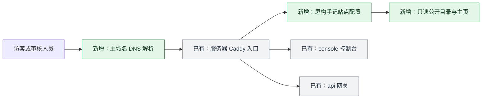
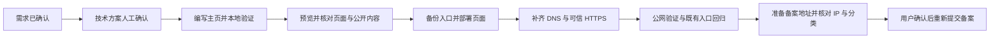

# 思构手记技术方案

日期：2026-10-28（北京时间）。状态：用户已于本聊天确认技术方案，进入实现与验证。

## 实现思路

采用静态网站：浏览器直接读取 HTML 页面与 CSS 样式文件。页面内容随代码维护，适合本期站点介绍、技术内容和项目说明。

项目源码独立保存于 `C:\Users\LHY95\Documents\Codex\sigou_note`，远程仓库为 `https://github.com/zjqylhy/sigou_note`。页面采用清晰的中文阅读布局，使用本地资源，兼顾桌面与手机。公开区域展示站点介绍及已核实的项目技术说明；备案页脚以工信部记录核对后的号码为准。

计划使用现有阿里云服务器 `47.113.231.252`。Caddy 是服务器当前使用的网站入口程序，负责按域名提供网页或转发请求。给它新增主域名站点，并将本项目的公开文件目录以只读方式接入；具体上线前备份实际入口配置及日常管理脚本。

## 新增实体

| 实体 | 定义与例子 | 用途 |
| --- | --- | --- |
| 独立网站项目 | 本项目仓库 `sigou_note` | 维护个人网站的需求、源码、部署和验证记录 |
| 公开文件目录 | 例如 `public/index.html`、`public/styles.css` | 只将允许公开的页面和资源提供给访客 |
| 项目说明 | 例如“Go 大模型网关：统一接入与计量的设计实践” | 介绍真实技术工作，正文经过公开范围核对 |
| 独立发布目录 | 例如服务器 `/opt/sigou-notes/releases/<版本>/public` | 保存可追溯版本，并支持切换回上一版本 |
| 主域名站点配置 | Caddy 中匹配 `linhengyi.xyz` 的独立配置段 | 为新网站选择公开目录并管理 HTTPS |

## 访问流程与变化

现状：主域名没有网站 DNS 记录，浏览器无法进入内容页面。计划在下图绿色位置新增解析、站点入口和公开页面；灰色部分为当前服务器已有能力。

DNS 是域名到服务器地址的映射。计划新增 `@` 的 A 记录指向 `47.113.231.252`，并新增 `www` 的 CNAME 记录指向主域名；CNAME 表示沿用另一个域名的解析。`www` 统一跳转主域名，正式备案访问地址使用 `https://linhengyi.xyz/`。

Caddy 为新域名申请并管理 HTTPS 证书，证书用于验证域名身份和建立加密连接。公开解析及端口具备条件后，验证证书实际签发与 HTTPS 响应。依据：[静态文件服务](https://caddyserver.com/docs/caddyfile/directives/file_server)、[自动 HTTPS](https://caddyserver.com/docs/automatic-https)。

## 实施与备案准备

- 网站部署配置与页面文件保存在独立项目；实际接入现有入口所需的挂载和配置引入记录清楚，并保留日常管理脚本的有效引用。
- 上线时先校验配置，保留上一版入口和文件，记录需要重载或重建的入口服务及影响。
- 核对现有三个备案 IP 与网站实际使用的各子域名，按真实使用范围填写。
- 网站分类按本次实际公开内容核对；涉及是否向公众提供生成式 AI 等业务事实时，请用户确认。
- 重新提交前展示准备好的页面与备案变更内容，并取得确认。

## 验证方式

1. 本地浏览器检查桌面与手机的内容、布局、站内链接及备案页脚。
2. 检查只发布 `public/`，未知路径返回 404，仓库和配置不可通过网页读取。
3. 使用两个公共 DNS 解析器检查主域名与 www，排除本机代理合成地址干扰。
4. 从本机和服务器验证 HTTPS 证书、首页 200、HTTP 跳转及 www 统一入口。
5. 检查现有控制台页面、API 未鉴权拒绝等行为；记录业务容器状态，回归不产生付费模型调用。
6. 验证通过后提交独立 commit、记录结果与限制，等待人工验收。

## 回退与限制

入口变更前保存有效配置、管理脚本及发布版本。失败时恢复这些文件并校验、重载入口，恢复原有域名服务；DNS 仅回退本次新增的记录。

目前未修改阿里云 DNS。实施时需要可用的阿里云登录状态或现有凭据；若需要登录、验证或确认，将在具体步骤说明。页面可访问与信息准确是重新提交的条件，最终审核结果由审核单位决定。
